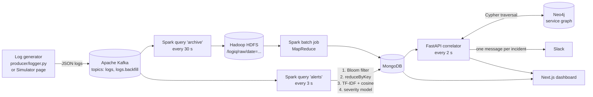

# LogIQ: A Distributed Big Data Framework for Smart Application Monitoring and Logging

**Course:** Big Data Analytics (BDA), Mini Project
**Domain:** DevOps, Site Reliability Engineering, Big Data Analytics
**Report date:** 29 September 2026

---

## Abstract

When a large software system fails, it produces thousands of near-identical error messages per second. Engineers on call are flooded with this noise and lose time finding the one service that actually broke. LogIQ is a monitoring system that removes this noise and finds the root cause automatically.

LogIQ follows a Lambda architecture. Logs flow through Apache Kafka into Apache Spark Structured Streaming. The speed layer drops healthy logs with a Bloom filter, merges duplicate errors with MapReduce and TF-IDF cosine similarity, and grades each resulting alert with a Logistic Regression classifier trained on real, published system logs (Loghub). Every raw log is also archived to Hadoop HDFS, where a batch MapReduce job computes weekly statistics. Alerts are stored in MongoDB. A FastAPI service traces each alert through a Neo4j graph of service dependencies to find the root cause, groups all alerts with the same root cause into one incident, suggests fixes from past incidents, and sends a single Slack message. A Next.js dashboard shows the incidents, the grouped alerts, an animated trace of the failure, and historical charts.

In the main stress test, a failure of one database produced **4,782 error logs from 5 services**. LogIQ reduced them to **9 alerts and 1 incident**, identified the correct root cause, and prepared exactly **one** notification. On message wording it had never seen, the severity classifier reached **0.750 accuracy and 0.778 macro F1**.

---

## 1. Problem statement

Modern applications are built from many small services that call each other. When one service fails, every service that depends on it starts failing too, and each one logs its own errors. A single database outage can therefore produce thousands of error lines per second from a dozen services. Traditional alerting sends one notification per error rule, so the engineer receives dozens of pages that all describe symptoms rather than the cause.

The project addresses three questions:

1. How can a system process a high-volume log stream in near real time without storing and analysing every healthy log line?
2. How can thousands of similar error messages be collapsed into a few meaningful alerts?
3. How can the system identify which service caused a failure, not just which services are reporting errors?

## 2. Objectives

- Ingest a continuous stream of JSON logs through a distributed message queue.
- Filter out healthy logs cheaply before any heavy processing.
- Group duplicate and near-duplicate error messages into single alerts.
- Classify each alert as High, Medium or Low severity with a machine learning model.
- Archive all raw logs in a distributed file system for historical batch analysis.
- Trace failures through a graph of service dependencies to find the root cause.
- Send exactly one notification per incident, with the root cause and a suggested fix.
- Present everything in a web dashboard, including a way to simulate failures for demonstration.

## 3. System architecture

LogIQ uses the **Lambda architecture**: a *speed layer* processes the live stream for immediate alerts, and a *batch layer* periodically recomputes aggregate views from the complete archived history.



| Layer | Component | Role |
|---|---|---|
| Ingestion | Apache Kafka 3.9 (KRaft mode) | Buffers the log stream. Topic `logs` for live traffic, `logs.backfill` for historical data. 3 partitions each. |
| Speed layer | Spark 4.0 Structured Streaming | Micro-batches every 3 seconds: filtering, grouping, classification. |
| Batch layer | Spark 4.0 (RDD MapReduce) | Recomputes hourly, daily and per-service statistics from HDFS. |
| Cold storage | Hadoop HDFS 3.4.1 | Stores every raw log as JSON, partitioned by date. |
| Hot storage | MongoDB 7 | Alerts, incidents, pipeline statistics, batch results, runbooks. |
| Graph store | Neo4j 5 | Service dependency graph used for root-cause tracing. |
| Serving | FastAPI (Python) | REST API, incident correlator, recommender, Slack notifier, simulator. |
| Presentation | Next.js 16, Tailwind CSS, Recharts, React Flow | Dashboard, incident reports, simulator. |

All infrastructure runs in Docker Compose. Spark, FastAPI and Next.js run on the host.

## 4. Mapping to the BDA syllabus

| Module | Concept | Where it is used in LogIQ |
|---|---|---|
| 2. MapReduce | `map` and `reduceByKey` over distributed data | Every streaming micro-batch groups errors by `(service, template)` with `reduceByKey` (`spark/stream.py`). The batch job computes errors per hour and service, logs per day and level, and the most frequent templates over the full HDFS archive (`spark/batch_mapreduce.py`). |
| 3. NoSQL | Document store and graph store | MongoDB holds alerts, incidents and statistics as JSON documents (`api/db.py`). Neo4j holds the service map as `(:Service)-[:DEPENDS_ON]->(:Service)` (`api/graph.py`). |
| 4. Mining data streams | Bloom filter | A Bloom filter, broadcast to all Spark executors, removes healthy logs from the stream before any expensive processing (`logiq/bloom.py`). |
| 5. Distance measures and machine learning | TF-IDF, cosine similarity, classification | Error templates become TF-IDF vectors. Pairs with cosine similarity of 0.90 or more are merged into one alert. Five classifiers (Naive Bayes, Logistic Regression, Linear SVM, Random Forest, neural network) are compared on real Loghub logs; the best, Logistic Regression, grades severity (`spark/train_model.py`, `spark/evaluate_model.py`). |
| 6. Link analysis and recommendation systems | Graph traversal, content-based recommendation | A Cypher path query walks the dependency graph to the root cause. A content-based recommender ranks past fixes by TF-IDF cosine similarity to the incident (`api/recommender.py`). |

## 5. Implementation

### 5.1 Data simulation

No production log feed was available, so LogIQ includes a realistic simulator (`producer/logger.py`, `logiq/templates.py`). The simulator drives the live demo only. The severity classifier is trained on real, published logs (Section 6.2).

- **Topology.** 14 services in 5 tiers, connected by 14 `DEPENDS_ON` edges (`config/topology.json`): 2 clients (WebFrontend, MobileApp), an API gateway, 5 API services, 4 data stores (UserDB, OrderDB, InventoryDB, SessionCache), a search index and an external payment gateway.
- **Normal traffic.** About 200 logs per second by default. Most are `INFO` and `DEBUG` request logs. About 6% are benign warnings (slow requests, GC pauses) and 1% are sporadic, low-impact errors.
- **Crash mode.** A failing service emits a burst of its own errors (1,000 by default). Every service that depends on it, directly or indirectly, then logs upstream failures. Each hop away from the root logs 60% as much as the hop below it. This recreates the cascade described in the problem statement.
- **Backfill mode.** Generates 7 days of historical logs with past timestamps, including daily busy hours and several past crashes, for the batch layer.
- Every message contains realistic variable values (latencies, request ids, IP addresses, row counts), so no two error lines are byte-for-byte identical.

Each log is a JSON document: `id`, `timestamp`, `service`, `host`, `level`, `message`, `trace_id`.

### 5.2 Ingestion with Kafka

Kafka runs as a single broker in KRaft mode, which replaces ZooKeeper in current Kafka releases. The generator writes to topic `logs`, keyed by service name so that each service's logs stay ordered within a partition. Historical backfill goes to a separate topic, `logs.backfill`, so that old logs reach the archive but never trigger live alerts.

### 5.3 Cold storage in HDFS

The Spark query `archive` (`start_archive()` in `spark/stream.py`) reads both Kafka topics and writes every log to HDFS every 30 seconds:

- Path: `hdfs://localhost:8020/logiq/raw/date=YYYY-MM-DD/`
- Format: JSON Lines, one folder per day (Hive-style partitioning, so the batch job can skip old days).
- Delivery: exactly once, through Spark's file sink and a checkpoint directory.
- Replication factor 1, matching the single datanode.

During testing the archive held 52.9 MB of logs across 8 daily partitions.

### 5.4 Speed layer: from raw logs to alerts

The Spark query `alerts` reads topic `logs` and processes one micro-batch every 3 seconds. Each batch passes through four stages.

**Stage 1: Bloom filter (stream mining).** The filter stores keys that identify healthy traffic: the log levels `INFO`, `DEBUG` and `TRACE`, and the masked templates of benign warnings such as `WARN|GC pause <*> (young gen)`. A log is dropped if either its level key or its template key is in the filter. The filter uses Kirsch–Mitzenmacher double hashing over one BLAKE2b digest.

| Parameter | Value |
|---|---|
| Design capacity | 5,000 keys |
| Target false-positive rate | 0.1% |
| Bit array size *m* | 71,887 bits (8,986 bytes) |
| Hash functions *k* | 10 |
| Distinct keys actually stored | 8 (3 levels + 5 benign templates) |
| Measured false positives | 0 in 200,000 random lookups |

A Bloom filter never gives false negatives, so no healthy log that was added to the filter can slip through. A false positive would drop a real error, which is why the target rate is low. The filter is broadcast once to all Spark executors and applied as a user-defined function. In the recorded run, it dropped **90%** of all logs (125,620 of 139,284) before any further processing.

**Stage 2: template masking and MapReduce.** Each error message is converted to a template by replacing every token that contains a digit with `<*>`:

```
Upstream UserDB request failed: 504 Gateway Timeout after 2950ms (req_id=req-123456)
Upstream UserDB request failed: <*> Gateway Timeout after <*> (req_id=<*>)
```

The batch is then reduced with `map((service, template) -> (1, level, sample, first, last))` followed by `reduceByKey`. This turns thousands of error lines into a handful of distinct `(service, template)` groups, each with a count and a time range.

**Stage 3: TF-IDF and cosine similarity.** Templates can still differ slightly in wording (for example "Query timeout" and "Query timed out ... (retry)"). Each template is tokenised (letters only), stop words are removed, and it is converted to a TF-IDF vector (HashingTF with 16,384 features, IDF fitted on the training corpus). Vectors are L2-normalised, so the dot product of two vectors equals their cosine similarity.

Grouping uses greedy leader clustering. Alerts that are already open act as the first cluster leaders, so new errors join an existing alert instead of creating a duplicate. Each new group, largest first, joins the most similar leader from the same service if the similarity is at least **0.90**; otherwise it becomes a new leader.

**Stage 4: Severity classification.** The same fitted pipeline ends with a Logistic Regression classifier, trained on real Loghub logs, that labels each alert High, Medium or Low (Section 6.2). The log level sets a floor, using the same rule as the training labels: an `ERROR` line is at least Medium and a `FATAL` or `CRITICAL` line is High. The model can raise a grade but never lower it below that floor. If an alert absorbs messages with different predictions, it keeps the highest severity.

Alerts are then inserted or updated in MongoDB in one bulk write. Per-batch statistics (logs received, dropped, errors, alerts created and updated, processing time) are also stored for the dashboard.

### 5.5 Batch layer: MapReduce over HDFS

`spark/batch_mapreduce.py` reads the last 7 days of archived logs from HDFS and runs four MapReduce jobs:

| Job | Map key | Output collection |
|---|---|---|
| Errors per hour per service | `(hour, service)` | `error_stats_hourly` |
| Errors per service | `service` | `error_stats_service` |
| Logs per day per level | `(day, level)` | `level_stats_daily` |
| Most frequent error templates | `(service, template)` | `top_templates` (top 10) |

The job replaces the previous results on each run, which is the standard batch-view recomputation of the Lambda architecture. In the recorded run it scanned **73,135 logs in 6.0 seconds** and produced 526 `(hour, service)` buckets.

### 5.6 Root-cause analysis with Neo4j

The dependency map is stored in Neo4j as 14 `:Service` nodes and 14 `:DEPENDS_ON` relationships, seeded from `config/topology.json`.

**Rule.** Starting from the service that raised an alert, follow `DEPENDS_ON` edges through services that are currently failing. The root cause is the deepest failing service on that path whose own dependencies are all healthy. If nothing downstream is failing, the alerting service is itself the root cause.

```cypher
MATCH path = (s:Service {name: $service})-[:DEPENDS_ON*0..]->(d:Service)
WHERE d.name IN $failing
  AND all(n IN nodes(path) WHERE n.name IN $failing)
  AND NOT EXISTS {
    MATCH (d)-[:DEPENDS_ON]->(x:Service) WHERE x.name IN $failing
  }
RETURN d.name AS root, [n IN nodes(path) | n.name] AS chain
ORDER BY length(path) DESC
LIMIT 1
```

Example: with WebFrontend, APIGateway, OrderAPI, AuthAPI and UserDB all failing, an alert from WebFrontend is traced along `WebFrontend > APIGateway > OrderAPI > AuthAPI > UserDB`, and UserDB is returned as the root cause.

### 5.7 Incident correlation and notification

The correlator (`api/correlator.py`) runs inside the FastAPI process every 2 seconds.

1. **Wait for the cascade.** An alert is only processed 8 seconds after it first appears, so that errors from the rest of the chain have time to arrive.
2. **Ignore sporadic noise.** An alert can open an incident only if it is Medium or High *and* is a burst: at least 25 logs at 0.5 logs per second or more. Only burst alerts count as "failing" for root-cause tracing. Without this rule, background errors made healthy services look failing and led to wrong root causes (Section 7).
3. **One incident per root cause.** Every alert is traced to its root cause. Alerts with the same root cause are filed under the same open incident.
4. **One notification per incident.** A Slack message is sent only when an incident is first opened. It contains the severity, root cause, failure path, affected services, the number of logs grouped, the top suggested fix, and a link to the incident page.
5. **Late root cause.** If errors from a deeper service arrive after an incident has opened, the existing incident is moved to the new root cause and Slack receives one short update, instead of a second incident.
6. **Auto-resolve.** An incident with no new errors for 10 minutes is resolved automatically.

### 5.8 Fix recommendations

Suggested fixes use **content-based recommendation**. Each runbook (a past failure and its fix) is an item profile built from its service name, title and symptom words, represented as a TF-IDF vector. The incident profile is built from the root-cause service and the error messages of that service only; messages from upstream services describe symptoms, not the cause. Runbooks are ranked by cosine similarity, and the top 3 are shown.

The system starts with 16 seed runbooks. When an engineer resolves an incident and describes the fix, that description becomes a new runbook. In testing, after resolving an OrderDB lock incident with a written fix, a new similar OrderDB error ranked that fix first with similarity **0.563**, ahead of the best seed runbook (0.452).

### 5.9 Dashboard and simulator

The Next.js front end has three pages:

- **Overview:** open incidents, pipeline totals, live throughput chart, error logs by service, the incident list, open alerts (All, Bursts and Sporadic tabs), and the 7-day history from the batch layer. A sidebar shows whether Kafka, Spark, HDFS, MongoDB, Neo4j and Slack are up.
- **Incident report:** the root cause, failure path, grouped alerts with their merged templates and model confidence, suggested fixes, a resolve form and a timeline. The dependency graph plays an animated replay in two phases: the failure spreading upward from the root, then LogIQ tracing it back down to the root cause, which ends highlighted in red.
- **Simulator:** start or stop background traffic, crash any service by clicking it on the graph, send custom log lines, and stop every running log stream (including generators started from a terminal) with one button.

## 6. Results and evaluation

### 6.1 End-to-end stress tests

Each test crashed one service while normal background traffic continued. All recorded on 28–29 September 2026 on a single laptop (Apple Silicon, 8 GB RAM, Docker limited to 4 GB).

| Failed service | Error logs produced | Services reporting errors | Alerts after grouping | Incidents | Notifications | Root cause found |
|---|---|---|---|---|---|---|
| OrderDB (2,000-error burst) | 4,782 | 5 | 9 | 1 | 1 | OrderDB (correct) |
| UserDB (1,000-error burst) | 2,750 | 6 | 11 | 1 | 1 | UserDB (correct) |
| SearchIndex (800-error burst) | 1,912 | 5 | 8 | 1 | 1 | SearchIndex (correct) |

For the OrderDB test this is a reduction from 4,782 raw error lines to 9 alerts (about 530 to 1) and to a single notification. The whole 2,000-error burst was handled in one micro-batch: in a comparable test, a batch containing 3,330 logs (2,753 of them errors) was processed in **644 ms**. Ordinary batches of about 580 logs took between 255 and 1,275 ms.

An incident opens about 10 seconds after the burst begins: the 8-second correlation delay plus up to 2 seconds until the next correlator pass. This delay is deliberate; it is what allows all cascade alerts to be grouped before the notification is sent.

**Pipeline totals** at one point during testing:

| Stage | Count |
|---|---|
| Logs ingested from Kafka | 139,284 |
| Dropped by the Bloom filter | 125,620 (90%) |
| Error logs kept for grouping | 13,564 |
| Alerts | 182 (1 alert per 74.5 error logs) |
| Incidents | 5 |

**Correlator behaviour** was also checked by an automated integration test against live MongoDB and Neo4j with a fake Slack server (`tests/test_correlator_integration.py`):

- AuthAPI and APIGateway alerts open one incident with root cause AuthAPI and send exactly one Slack message.
- A 3-log OrderAPI alert in the same window is ignored and does not affect tracing.
- When UserDB errors arrive 10 seconds later, the same incident moves to root cause UserDB with path `APIGateway > AuthAPI > UserDB`, and exactly one update message is sent.
- After the quiet period, the incident is resolved and all its alerts are closed.

All 6 automated tests pass.

### 6.2 Severity classifier

**Dataset.** The classifier is trained only on real, published logs from **Loghub** (Zhu et al., ISSRE 2023; Zenodo, doi:10.5281/zenodo.8196385), a standard benchmark collection for log analytics. `spark/prepare_dataset.py` downloads five Loghub datasets and parses them with Spark:

| Source | System | Labelled lines | Rows kept |
|---|---|---|---|
| BGL | BlueGene/L supercomputer, Lawrence Livermore National Labs | 1,011,297 | 60,913 |
| Apache | Apache HTTP server error log | 38,249 | 9,631 |
| Zookeeper | ZooKeeper ensemble | 46,493 | 2,628 |
| Hadoop | MapReduce jobs with injected machine, network and disk failures | 11,976 | 1,301 |
| OpenStack | Nova compute service | 3,306 | 547 |
| **Total** | | **1,111,321** | **75,020** |

**Labels.** Every label comes from a field already present in the published data:

| Class | Rule | Rows |
|---|---|---|
| High | BGL lines tagged as alerts by the system administrators (Oliner and Stearley, DSN 2007); `FATAL` or `CRITICAL` lines in the other systems | 8,457 |
| Medium | `ERROR`, `SEVERE` or `FAILURE` lines; BGL `FATAL` lines without an alert tag (Oliner and Stearley show that the BGL level field overstates severity) | 58,605 |
| Low | `WARN` and `WARNING` lines | 7,958 |

`INFO`, `DEBUG` and `notice` lines are left out because the stream only grades errors. The raw data repeats the same message hundreds of thousands of times, so at most 300 copies of each (source, template, class) are kept. Variable tokens are masked to build templates (1,382 distinct templates remain).

**Features.** Letters-only tokens without stop words become TF-IDF vectors (HashingTF with 16,384 features, then IDF). Word bigrams get a second TF-IDF vector of the same size. The two are concatenated into 32,768 features. Random Forest and the neural network get the top 2,000 features by ANOVA F-test, because Spark trains them far more slowly on 32,768 sparse columns. The stream still uses the unigram TF-IDF vector for cosine-similarity clustering, so clustering is unchanged.

**Class imbalance.** Medium is 78% of rows. Models that support it get balanced class weights (total rows divided by 3 times the class count), and models are ranked by **macro F1**, which weights the three classes equally.

**Evaluation method.** 5-fold cross-validation grouped by message family: each template's first six words are hashed into a fold, so near-identical variants never appear on both sides of a split. Every score below is measured on message families the model never saw in training (`spark/evaluate_model.py`, results in `models/metrics.json`).

**Model comparison** (75,020 rows, 5-fold grouped cross-validation, Spark MLlib, one laptop):

| Model | Accuracy | Macro F1 | Weighted F1 | Cohen's kappa | Time (s) |
|---|---|---|---|---|---|
| **Logistic Regression** (multinomial, elastic net: reg 0.001, L1 ratio 0.5) | 0.847 | **0.713** | 0.843 | **0.556** | 48 |
| Random Forest (100 trees, depth 15) | **0.863** | 0.702 | **0.848** | 0.546 | 136 |
| Neural network (multilayer perceptron 2000-64-3) | 0.808 | 0.700 | 0.818 | 0.524 | 534 |
| Linear SVM (one-vs-rest) | 0.805 | 0.646 | 0.803 | 0.454 | 327 |
| Multinomial Naive Bayes (previous model) | 0.626 | 0.560 | 0.670 | 0.343 | 11 |

Logistic Regression is saved for the stream. It has the best macro F1 and kappa, trains fastest of the strong models, and outputs class probabilities, which the dashboard shows as confidence. Linear SVM has no probabilities, so it could not be deployed anyway. Gradient-boosted trees were also tried (one-vs-rest, since Spark's GBT is binary only) but did not finish one cross-validation run in 15 minutes and have no probabilities, so they were dropped. The three strongest models beat Naive Bayes by 0.14 to 0.15 macro F1. Naive Bayes with the old unigram-only features scores 0.594 macro F1, so bigrams do not explain the gap.

**Logistic Regression in detail:**

| Class | Precision | Recall | F1 | Support |
|---|---|---|---|---|
| High | 0.610 | 0.569 | 0.589 | 8,457 |
| Medium | 0.888 | 0.925 | 0.906 | 58,605 |
| Low | 0.744 | 0.570 | 0.645 | 7,958 |

| True \ Predicted | High | Medium | Low |
|---|---|---|---|
| High | 4,813 | 3,550 | 94 |
| Medium | 2,922 | 54,212 | 1,471 |
| Low | 161 | 3,259 | 4,538 |

**Error analysis.**

- Most mistakes are with the Medium class, in both directions. Only 94 High lines (1.1%) are graded Low, so real failures are almost never hidden.
- High is the hardest class. It has only 83 distinct templates, so a held-out fold often contains failure wording that appears nowhere else.
- Random Forest is the most precise for High (0.874) but finds fewer High lines (recall 0.484). The neural network finds the most (recall 0.747) but raises more false alarms (precision 0.445). Logistic Regression sits between them.

**Transfer to the LogIQ simulator.** The same model was also scored on 390 simulator messages. These carry a different kind of label ("the service itself is broken" versus "a dependency is broken"), so this is a test of domain transfer, not of the model. Accuracy is only 0.256: the model grades almost every simulator message Medium, the most common class in Loghub. For this reason the stream applies the log-level floor described in Section 5.4, which uses the same rule as the training labels. The paging rule needs Medium or High, so crash alerts still open incidents.

## 7. Problems found during testing

Several defects were found by running the whole system end to end and were fixed. They are recorded here because they illustrate real pitfalls of distributed pipelines.

| Problem | Cause | Fix |
|---|---|---|
| No incident ever opened after the first crash | PySpark returns timestamps as naive local time (IST, +05:30). They were stored as if they were UTC, so every alert appeared 5.5 hours in the future. | Convert with `astimezone(timezone.utc)` before storing. |
| One crash produced 2 incidents, one with the wrong root cause | Sporadic Medium errors on unrelated services marked them as "failing", so the graph traversal walked into a healthy branch. | Only burst alerts (25+ logs at 0.5/s or more) count as failing. |
| The same error type split into several alerts | Similarity was computed on raw sample messages, so different URL paths lowered cosine similarity below 0.90. | Compute TF-IDF on masked templates instead of raw samples. |
| Recommendations favoured generic "upstream timeout" runbooks | The incident profile included all upstream error messages, which outnumber the root service's own messages. | Build the incident profile only from the root-cause service's messages. |
| 78% of HDFS blocks reported as under-replicated | The Spark HDFS client requested 3 copies, but the cluster has 1 datanode. | Set `dfs.replication=1` for Spark and reset existing files with `hdfs dfs -setrep`. |
| Sporadic alerts not visible on the dashboard | The alert table opened on the "Bursts" tab, and the API returned only the 100 largest alerts. | Add a default "All" tab sorted by time and return the 200 newest alerts. |

## 8. Limitations

- **Simulated live traffic.** The severity model is trained and evaluated on real Loghub logs, but the live demo still runs on simulated microservice logs. These come from a different kind of system than Loghub (supercomputer, Hadoop, OpenStack), so the model's grades on simulator messages are less reliable than its cross-validation score (Section 6.2).
- **Labels from log levels.** Loghub has no hand-made severity labels for most lines. Labels come from the BGL administrators' alert tags and from each line's published log level. A log level is the developer's opinion, not a measured impact.
- **Single-node deployment.** Kafka, HDFS, MongoDB and Neo4j each run as one node, and Spark runs in local mode. The design uses distributed components, but scaling and fault tolerance across machines were not tested.
- **Static dependency graph.** The service map is loaded from a file. Real systems change constantly and would need the graph to be discovered, for example from distributed tracing.
- **Fixed thresholds.** The cosine threshold (0.90), burst rule (25 logs, 0.5/s) and correlation delay (8 s) were chosen by hand for this simulator, not tuned on real data.
- **Over-sized Bloom filter.** The filter is sized for 5,000 keys but holds only 8, so its real false-positive rate is far below the 0.1% target. This is harmless, but a production version would size it from real healthy-template counts.
- **Polling instead of push.** The API polls MongoDB every 2 seconds rather than using change streams, which would need a MongoDB replica set.

## 9. Future work

- Add more Loghub systems (Thunderbird, Spark, HDFS v2) and run the data preparation on the HDFS cluster instead of local disk.
- Try a pretrained language model (for example a small BERT fine-tuned on log text) as a further comparison.
- Replace regex template masking with a dedicated log parser such as Drain.
- Build the dependency graph automatically from distributed traces (OpenTelemetry).
- Use anomaly detection on error rates, so that a slow increase in errors can also open an incident.
- Run Kafka, HDFS and Spark as multi-node clusters to measure throughput and recovery under node failure.

## 10. Conclusion

LogIQ shows that the main ideas of the Big Data Analytics syllabus combine into a working answer to a real operational problem. A Bloom filter removed 90% of the stream at almost no cost. MapReduce and TF-IDF cosine similarity turned thousands of error lines into a few alerts. A Logistic Regression model trained on 75,020 real Loghub log lines graded them. It reached 0.847 accuracy and 0.713 macro F1 on unseen message families, against 0.560 for Naive Bayes. A graph traversal in Neo4j found the correct root cause in every crash test. In the largest test, 4,782 error logs from 5 services became one incident and one notification, which is the outcome the project set out to achieve.

## Appendix A: How to run

Requirements: Docker Desktop (about 4 GB of memory), Python 3.13, Java 17 or 21, Node.js 20 or later.

```bash
make install     # Python virtual environment and frontend packages
make infra       # Kafka, HDFS, MongoDB, Neo4j in Docker
make setup       # Kafka topics, HDFS folder, Neo4j graph, train the model
make stream      # Spark streaming job            (terminal 1)
make api         # FastAPI on port 8000           (terminal 2)
make web         # dashboard on port 3000         (terminal 3)
make crash       # stress test: 2,000 OrderDB errors plus the cascade
make backfill    # 7 days of history, then:
make batch       # MapReduce over HDFS for the history charts
make evaluate    # model metrics -> models/metrics.json
make test        # automated tests
```

The Simulator page at `http://localhost:3000/simulate` can be used instead of the command-line generator.

## Appendix B: Project structure

| Path | Contents |
|---|---|
| `config/topology.json` | 14 services and their dependencies |
| `data/runbooks.json` | 16 seed runbooks for fix recommendations |
| `logiq/` | Shared code: settings, Bloom filter, message templates, template masking, stream control |
| `producer/logger.py` | Command-line log generator (steady, crash and backfill modes) |
| `spark/stream.py` | Speed layer and HDFS archive |
| `spark/batch_mapreduce.py` | Batch layer |
| `spark/prepare_dataset.py` | Downloads Loghub and builds the labelled training set |
| `spark/train_model.py`, `spark/evaluate_model.py` | Severity model training and classifier comparison |
| `api/` | FastAPI app, correlator, Neo4j access, recommender, Slack notifier, simulator |
| `frontend/` | Next.js dashboard |
| `tests/` | Unit and integration tests |
| `docker-compose.yml` | Kafka, HDFS namenode and datanode, MongoDB, Neo4j |

## References

1. B. H. Bloom, "Space/time trade-offs in hash coding with allowable errors," *Communications of the ACM*, 13(7), 1970.
2. A. Kirsch and M. Mitzenmacher, "Less hashing, same performance: Building a better Bloom filter," *European Symposium on Algorithms*, 2006.
3. J. Leskovec, A. Rajaraman and J. D. Ullman, *Mining of Massive Datasets*, 3rd ed., Cambridge University Press, 2020.
4. N. Marz and J. Warren, *Big Data: Principles and Best Practices of Scalable Realtime Data Systems*, Manning, 2015 (Lambda architecture).
5. J. Dean and S. Ghemawat, "MapReduce: Simplified data processing on large clusters," *OSDI*, 2004.
6. J. Zhu et al., "Tools and benchmarks for automated log parsing," *ICSE-SEIP*, 2019.
7. P. He et al., "Drain: An online log parsing approach with fixed depth tree," *ICWS*, 2017.
8. Apache Spark documentation: Structured Streaming Programming Guide and MLlib Guide, version 4.0.
9. Apache Kafka documentation, version 3.9; Apache Hadoop HDFS documentation, version 3.4.
10. Neo4j Cypher Manual, version 5.
11. J. Zhu, S. He, P. He, J. Liu and M. R. Lyu, "Loghub: A large collection of system log datasets for AI-driven log analytics," *ISSRE*, 2023. Data: Zenodo, doi:10.5281/zenodo.8196385.
12. A. J. Oliner and J. Stearley, "What supercomputers say: A study of five system logs," *DSN*, 2007 (BGL alert labels).
13. Q. Lin, H. Zhang, J.-G. Lou, Y. Zhang and X. Chen, "Log clustering based problem identification for online service systems," *ICSE*, 2016 (Hadoop logs).
